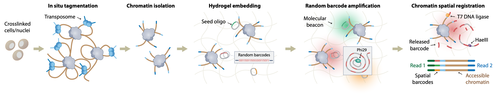

# Overview of AMBER
AMBER (AMplification of random Barcodes for co-Embedded chromatin Registration) is a proximity ligation-free hydrogel-based platform that enables scalable identification of colocalized accessible chromatin without special reagents or equipment. 

## Processing AMBER datasets
The steps of the AMBER processing pipeline from raw data generated by the Ultima Genomics platform (CRAM) to accessible chromatin hubs (clusters) are as follows:

1. QC and Filtering of reads by construct design baits  
2. Extraction of beacon spatial barcodes
3. Alignment to reference genome (bwamem2) -> *.bam, *.bw
4. Barcoding-hub grouping, fragment-aware deduplication (bamsplit) -> *.clusters, *.cool

## Construct designs 
The AMBER library construct designs is as follows

< inject Image: *Placeholder Text: Image to be added later* >

For more details, please refer to our Extended Fig 2 in our BioRxiv preprint <link>.

## Data and Citation:

If you are interested in applying our methods or datasets, please refer to the following resources:

Read our preprint: < BioRxiv link>
Access the dataset: GEO Accession GSE162511
The step-by-step protocol is provided: 
