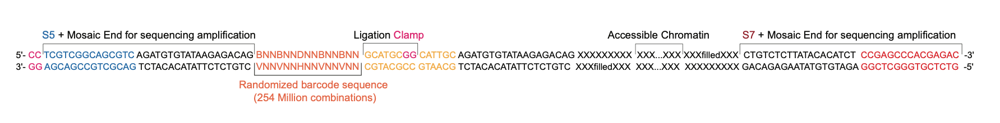

# Overview of AMBER
AMBER (AMplification of random Barcodes for co-Embedded chromatin Registration) is a proximity ligation-free hydrogel-based platform that enables scalable identification of colocalized accessible chromatin without special reagents or equipment. 


## Processing AMBER datasets
The steps of the AMBER processing pipeline from raw data generated by the Ultima Genomics platform (CRAM) to accessible chromatin hubs (clusters) are as follows:

1. QC and Filtering of reads by construct design baits  
2. Extraction of beacon spatial barcodes
3. Alignment to reference genome (bwamem2) -> *.bam, *.bw
4. Barcoding-hub grouping, fragment-aware deduplication (bamsplit) -> *.clusters, *.cool

> [!NOTE]
> Please have the following softwares installed before running the processing pipeline.

  <details>

  _**<summary> Package Requirements </summary>**_
  
  Name | Link
  --- | ---
  bwa-mem2 (2.2.1)  | [http://linktobwamem](https://github.com/bwa-mem2/bwa-mem2 )
  samtools (>1.3) | [link](https://github.com/samtools/samtools  )
  cutadapt (4.4) | [link](https://github.com/marcelm/cutadapt )
  bedtools | https://github.com/arq5x/bedtools2
  UMI-tools | https://github.com/CGATOxford/UMI-tools
  </details>
  
A tutorial with a reduced size raw data example is provided in the [Resources folder](docs/AMBER_C2_200kb.CRAM)
```bash
# Download the AMBER github processing scripts
wget https://github.com/czhulab/AMBER something
unzip main.zip

# Run the Processing
cd ../../resources
unzip AMBER_thing.zip

# Visualize some QC data
Rscript something
Python something


```

## Construct designs 
The AMBER library construct designs is as follows:



For more details, please refer to our Extended Fig 2 in our bioRxiv [preprint](https://www.biorxiv.org/content/10.64898/2026.06.02.729594v1).

## Data and Citation:

If you are interested in applying our methods or datasets, please refer to the following resources:



1. Read our preprint: [preprint](https://www.biorxiv.org/content/10.64898/2026.06.02.729594v1).
2. Access the dataset: GEO Accession GSE162511
3. The step-by-step protocol is provided: [protocol](Protocol/AMBER_Protocol.pdf)
